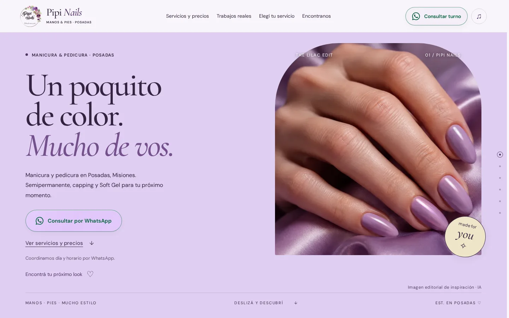
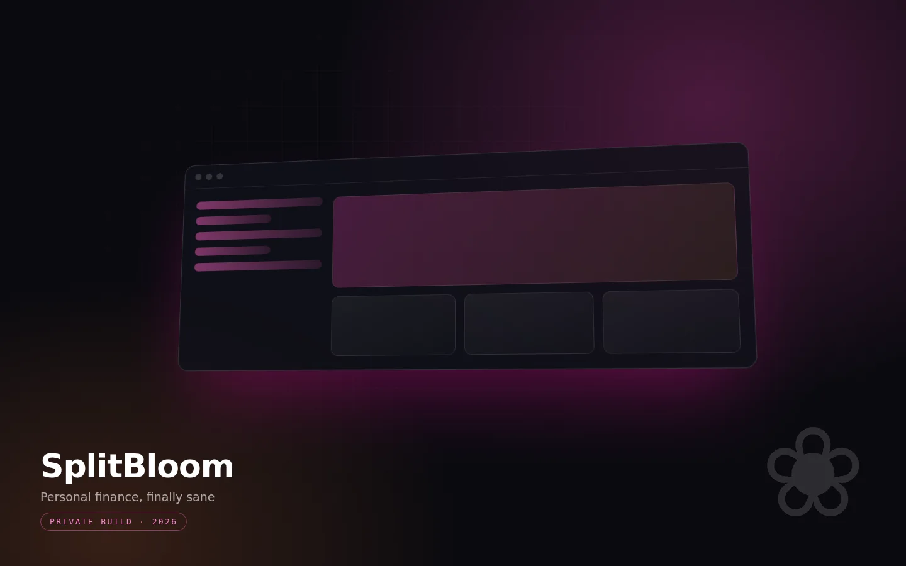
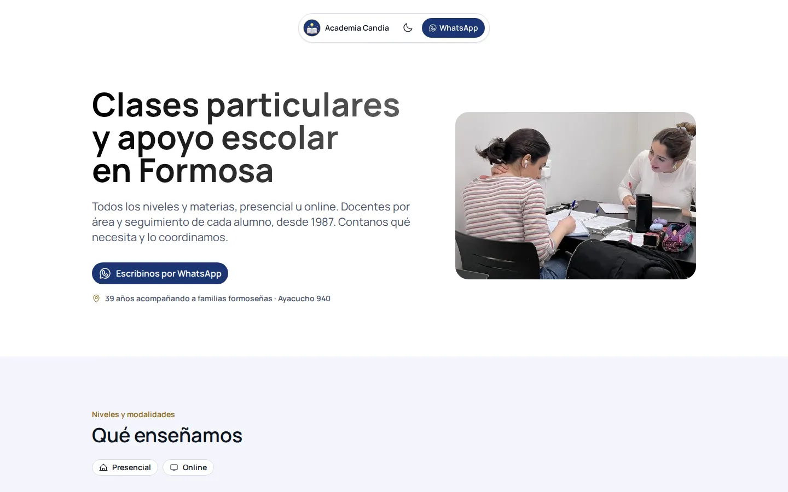
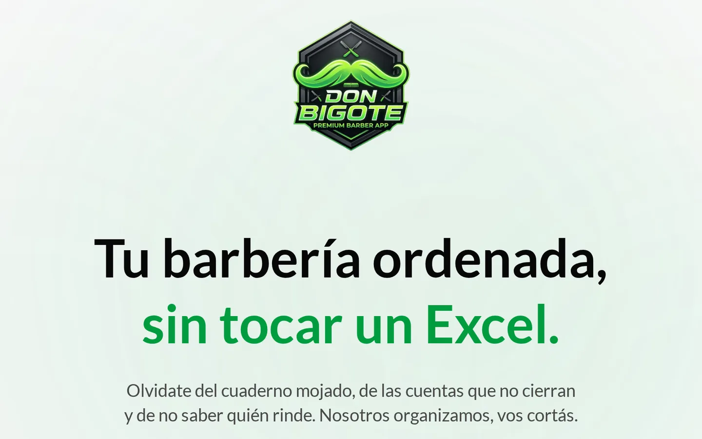
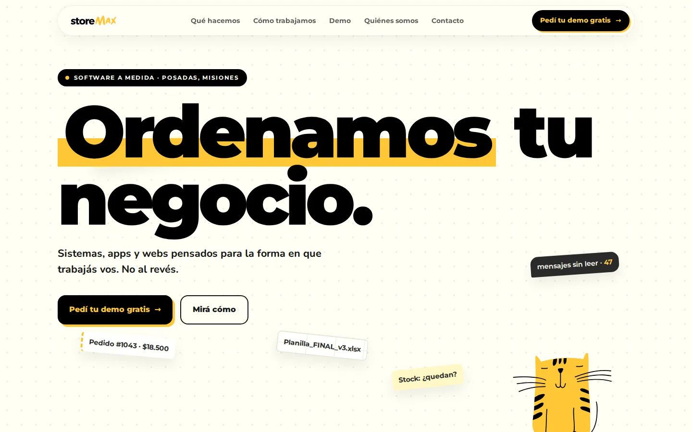
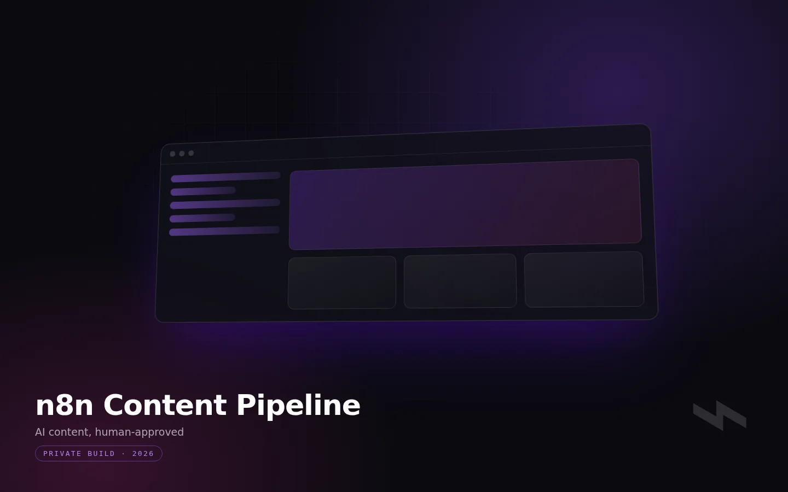

<a href="https://candiamaximiliano.dev">
  <picture>
    <source media="(prefers-color-scheme: dark)" srcset="./assets/banner-dark.svg">
    
  </picture>
</a>

  
  
  
  
  

  <b>Full Stack Developer</b> at <b>emBlue Latam</b> and founder of <a href="https://storemax.ar"><b>StoreMax</b></a> — <b>6 products in production</b> in 2026. 
  Fixed scope in writing, a live preview every week, a launch your team can run.

🇦🇷 ¿Preferís leer en español? → <a href="https://candiamaximiliano.dev/es/">candiamaximiliano.dev/es</a>

---

## ⚡ What I can build for you

| Service | What you get |
|---|---|
| 🚀 **SaaS & MVP builds** | From first screen to paying users: auth, data model, dashboards, deploy. |
| 📅 **Booking & business systems** | Appointments, enrollment, payments, schedules and client history. |
| 🪶 **Fast landing pages** | Astro sites on Cloudflare Workers, with motion that doesn't cost load time. |
| 🤖 **Automation & AI workflows** | n8n pipelines that draft, route for approval and publish on schedule. |
| 🏗️ **Legacy modernization** | Moving .NET monoliths toward services, with React and Node.js on top. |

Something else? [Send a brief](mailto:hello@candiamaximiliano.dev?subject=Project%20brief) and get a straight answer on fit.

## 🛠️ Shipped in 2026

<table>
  <tr>
    <td width="50%" valign="top">
      
      <h3><a href="https://pipinails.com.ar">Pipi Software</a> 🟢 Live</h3>
      Multi-tenant booking SaaS for nail studios, with an AI pipeline that drafts, reviews and publishes each studio's Instagram posts on schedule. 
      <code>TanStack Start</code> <code>React 19</code> <code>n8n</code> <code>InsForge</code> <code>Cloudflare Workers</code>
    </td>
    <td width="50%" valign="top">
      
      <h3><a href="https://splitbloom.com">SplitBloom</a> 🟢 Live</h3>
      Personal finance without the mess: installments spread across months, shared spaces with per-member splits, a monthly close, offline-first sync. 
      <code>React 19</code> <code>TypeScript</code> <code>TanStack Query</code> <code>InsForge</code> <code>Cloudflare Workers</code>
    </td>
  </tr>
  <tr>
    <td width="50%" valign="top">
      
      <h3><a href="https://academiacandia.com.ar">Academia Candia</a> 🟢 Live · client project</h3>
      One platform for enrollment, payments and schedules. Staff publish the price list and it renders live on the Astro landing. 
      <code>React 19</code> <code>Astro</code> <code>PostgreSQL</code> <code>InsForge</code> <code>Cloudflare Workers</code>
    </td>
    <td width="50%" valign="top">
      
      <h3><a href="https://donbigote.app">Don Bigote</a> 🟢 Live</h3>
      Barbershop management: time slots, stylist choice, cash register, waiting queue, payroll and KPIs, with CSP-locked builds per deployment. 
      <code>React 19</code> <code>Tailwind v4</code> <code>Zod</code> <code>InsForge</code>
    </td>
  </tr>
  <tr>
    <td width="50%" valign="top">
      
      <h3><a href="https://storemax.ar">StoreMax</a> 🟢 Live · my studio</h3>
      The studio's site: Astro with View Transitions and a Three.js + GSAP scroll experience. 
      <code>Astro</code> <code>Three.js</code> <code>GSAP</code> <code>Cloudflare Workers</code>
    </td>
    <td width="50%" valign="top">
      
      <h3>n8n Content Pipeline ⚙️ In production</h3>
      Topic → three proposals → draft → artwork → Telegram review → publish only on approval. 
      <code>n8n</code> <code>TypeScript</code> <code>Telegram API</code> <code>InsForge</code>
    </td>
  </tr>
</table>

Problem, solution and my role for each one → <a href="https://candiamaximiliano.dev/#work"><b>case studies</b></a>

## 🤝 How we'll work

| 1 · Discovery call | 2 · Fixed-scope proposal | 3 · Weekly demos | 4 · Launch & handover |
|---|---|---|---|
| Goals, users, constraints and what "done" means for you. | Scope, milestones and timeline in writing, **before any code**. | Every week you click through real progress on a live preview URL. | Production deploy, then a handover so your team can run it. |

**You own the code** — repository, hosting and accounts in your name from day one. 
Typical timelines: landing page **1–2 weeks** · MVP **4–8 weeks**. Final dates go in the proposal.

## 🧰 Toolbox

  
  
  
  
  
  
  
  
   
  
  
  
  
  
   
  
  
  
  
  
  
  

## 📈 Track record

- **Full Stack Developer · emBlue Latam** Aug 2022 – present — moving a legacy .NET monolith toward Node.js microservices, new features in React and TypeScript, query tuning across MySQL, MSSQL and PostgreSQL with Redis caching.
- **Founder & developer · [StoreMax](https://storemax.ar)** Oct 2026 – present — the studio behind the products above: architecture, product decisions, build and deploy.
- **Freelance Full Stack Developer** 2021 – present — web apps for small businesses and academies.
- **Mentor, MERN stack · Henry** 2023 – 2024 and **Tutor · Coderhouse** 2022 – 2023 — code reviews, debugging sessions and JavaScript, React and backend courses for full stack students.

🎓 Systems Analysis at IES (graduating July 2027) · IT Technician, UNaM · 🗣️ Spanish (native) · English (B2) · 📍 Posadas, Argentina · GMT−3

---

  <b>Tell me what you're building. I'll tell you how I'd ship it.</b> 
  Next step: a discovery call, then a fixed-scope proposal in writing.  
  
  

